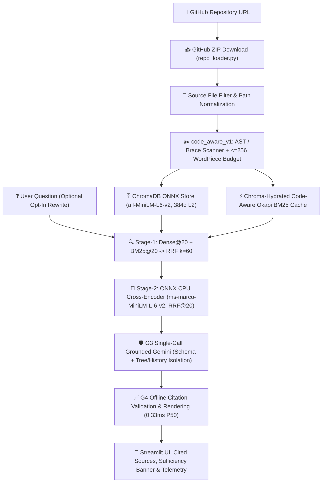
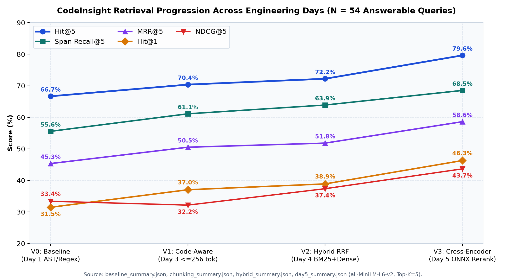
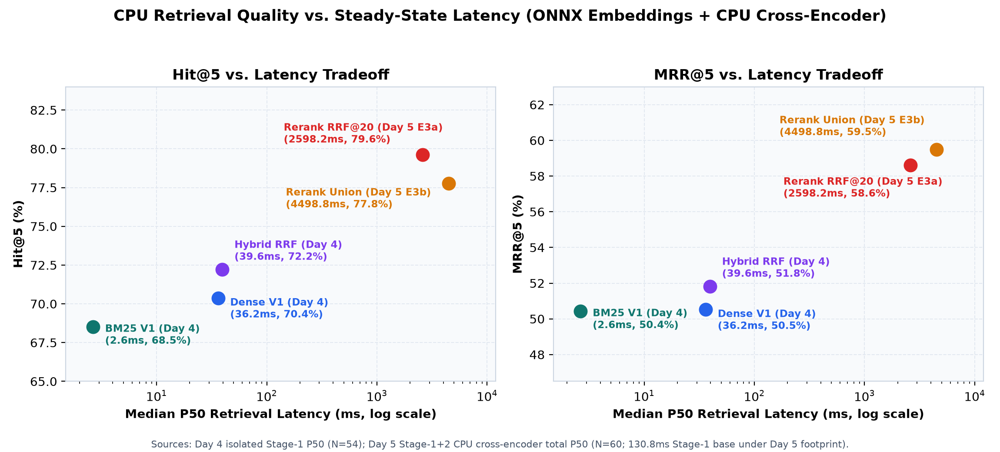
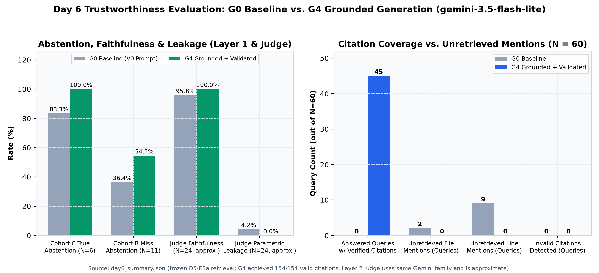

# 🧠 CodeInsight AI Assistant (`v1.0.0`)

A framework-free, citation-verified Retrieval-Augmented Generation (RAG) assistant that indexes public GitHub repositories and answers architectural and code-level questions across **Python, JavaScript/TypeScript, Java, C, and C++** without LangChain or PyTorch dependencies.

Built and systematically optimized across a **7-day controlled engineering roadmap** against a pinned 253-file / 60-question benchmark (`pallets/flask`, `expressjs/express`, `fmtlib/fmt`).

---

## ✨ Key Capabilities (`V4` Production Pipeline)

- **Code-Aware Hierarchical Chunking (`code_aware_v1`):** Walks top-level Python AST and stateful JS/Java/C/C++ brace, comment, string, and preprocessor-macro blocks, keeping nested helpers cleanly inside their enclosing function/method and bounding every chunk to **`<=256` WordPiece tokens** (`0.00%` truncation) with compact contextual headers (`File`, `Language`, `Type`, `Class`/`Symbol`, `Part i/N`, `Signature`).
- **Local ONNX-Only Inference (Zero PyTorch):** Runs dense 384d embeddings (`all-MiniLM-L6-v2` via ChromaDB ONNX) and Stage-2 CPU cross-encoder reranking (`cross-encoder/ms-marco-MiniLM-L-6-v2` via `onnxruntime` + `tokenizers`, `86.80 MB`, `0.0%` pair truncation) cleanly on Windows + Python 3.14.
- **Two-Stage Hybrid Retrieval (`D5-E3a`):** Fuses ChromaDB dense vector search (`Top-20`) with V1 header-hygienic, zero-overlap-filtered Code-Aware Okapi BM25 (`Top-20`, hydrated directly from ChromaDB with zero pickles) via Reciprocal Rank Fusion (`RRF k=60`, Candidate Union ceiling `96.3%`), then reranks RRF `Top-20` with the ONNX Cross-Encoder. Includes an optional opt-in conversational query rewriter (`default = False` per Day 5 empirical evidence).
- **Grounded Generation & Offline Citation Validation (`G3 + G4`):** Single-call Pydantic-structured Gemini generation (`strong` / `partial` / `insufficient` evidence sufficiency + `abstained` flag) paired with deterministic pure-Python `[EVIDENCE_i]` resolution, invalid-citation single-pass blocking, directory-tree isolation, and `(UNVERIFIED)` chat-history isolation (`0.33 ms` offline P50). Defaults to `gemini-3.5-flash-lite` with an optional UI selector and preserved V0 anchor [`llm.py`](llm.py).
- **No Local Git Required:** Downloads public repositories directly via GitHub ZIP archives ([`repo_loader.py`](repo_loader.py)).
- **Interactive Transparency UI & Telemetry:** Streamlit chat app exposing sidebar pipeline toggles, clickable verified `path:start–end` citations, cleaned `🔍 Retrieved Code Chunks` inspection, and crash-safe atomic telemetry ([`telemetry.py`](telemetry.py)).

---

## 🏗️ `V4` Production Architecture



---

## 📊 7-Day Controlled Benchmark Progression (`N = 54` Answerable / `N = 60` Total)

All benchmarks reuse pinned snapshots (`pallets/flask`, `expressjs/express`, `fmtlib/fmt` — `253` files, `71` verified ground-truth evidence spans) with cross-day `0.0` baseline parity verification and deterministic interval-overlap scoring.

### 1. Retrieval Optimization (`V0` $\rightarrow$ `V3`)

| Version | Day | Strategy / Stage | Chunks | Hit@1 | Hit@3 | Hit@5 | Prec@5 | SpanRec@5 | MRR@5 | NDCG@5 | Truncation |
| :--- | :-: | :--- | :---: | :---: | :---: | :---: | :---: | :---: | :---: | :---: | :---: |
| **`V0`** | 1 | `existing_chunker_v0` + Dense L2 (`MiniLM-L6-v2`) | `4,272` | `0.3148` | `0.5741` | `0.6667` | `0.1815` | `0.5556` | `0.4534` | `0.3339` | `14.61%` |
| **`V1`** | 3 | `code_aware_v1` (AST/Brace + `<=256` WordPiece) | `3,721` | `0.3704` | `0.6296` | `0.7037` | `0.2185` | `0.6111` | `0.5052` | `0.3217`\* | **`0.00%`** |
| **`V2`** | 4 | `D4-E2`: Dense@20 + BM25@20 + RRF (`k=60`) | `3,721` | `0.3889` | `0.6296` | `0.7222` | `0.2444` | `0.6389` | `0.5182` | `0.3737` | **`0.00%`** |
| **`V3` *(Default)*** | 5 | `D5-E3a`: `RRF@20` $\rightarrow$ ONNX Cross-Encoder | `3,721` | `0.4630` | **`0.7037`** | **`0.7963`** | **`0.2704`** | **`0.6852`** | `0.5861` | `0.4366` | **`0.00%`** |
| *`D5-E3b` (Union)* | 5 | *Candidate Union (`<=40`) $\rightarrow$ Cross-Encoder* | `3,721` | ***`0.4815`*** | `0.7037` | `0.7778` | `0.2667` | `0.6759` | ***`0.5948`*** | ***`0.4391`*** | ***`0.00%`*** |

*\*Day 3 NDCG@5 (`0.3339` $\rightarrow$ `0.3217`) reflects larger corpus `IDCG@5` denominators after restoring Python module globals (`66/83` Flask files) and cleanly splitting large C++ files under 256 tokens; every Top-1/Top-5 hit and span recall metric improved markedly.*



<details>
<summary>📈 Additional Visual Charts: Stage-1 Ceiling, CPU Latency vs. Quality Tradeoff & Day 6 Grounding Reliability</summary>






</details>

### 2. Trustworthy Grounded Generation (`G0` Baseline vs. `G4` Grounded + Validated)

Evaluated on frozen `D5-E3a` Top-5 retrieval (`300/300` chunks verified; **43** Cohort A Hits, **11** Cohort B Misses, **6** Cohort C Unanswerable) across `204/204` live calls on `gemini-3.5-flash-lite`:

| Evaluation Metric | `G0` Baseline (`V0` Prompt) | `G4` Grounded + Validated |
| :--- | :---: | :---: |
| **JSON Schema Validity (`N = 60`)** | `—` *(free text)* | **`1.0000`** (`60/60`) |
| **Token-Level Citation Validity (`N = 60`)** | `N/A` | **`1.0000`** (`154/154` tokens) |
| **Answered Queries w/ Verified Citations** | `0.0000` (`0/45`) | **`1.0000`** (`45/45`) |
| **Queries w/ Unretrieved File Mentions** | `2` | **`0`** |
| **Queries w/ Unretrieved Line Mentions** | `9` | **`0`** |
| **Cohort C True Abstention (`N = 6` Unanswerable)** | `0.8333` (`5/6`) | **`1.0000`** (`6/6`) |
| **Cohort B Miss Abstention (`N = 11` Retrieval Miss)** | `0.3636` (`4/11`) | **`0.5455`** (`6/11`; remaining `5/11` strictly `partial`) |
| **Blinded Judge Strict Faithfulness (`N = 24`, approx.\*)** | `0.9583` (`23/24`) | **`1.0000`** (`24/24`) |
| **Blinded Judge Parametric Leakage (`N = 24`, approx.\*)** | `0.0417` (`1/24`) | **`0.0000`** (`0/24`) |
| **Generation P95 Latency (`s`) + Offline Validation** | `2.8393s` | **`2.1810s`** (`P50 1.8369s`) + **`0.33 ms`** offline |

*\*Layer 2 Judge used `gemini-3.5-flash-lite` (same model family as the generator) and is reported strictly as approximate evaluation. See [`reports/FINAL_PROJECT_SUMMARY.md`](reports/FINAL_PROJECT_SUMMARY.md) for full methodology, rejected alternatives, and limitations.*

---

## 📁 Repository Organization

```text
├── app.py                         # Streamlit UI, sidebar pipeline controls, citation viewer & telemetry
├── chunker.py                     # Strategy dispatcher + preserved V0 AST/regex/sliding-window chunker
├── chunker_v1.py                  # Day 3 code_aware_v1 hierarchical Python AST + JS/C++ brace chunker (<=256 tok)
├── embedder.py                    # ChromaDB client, dense/BM25/hybrid RRF/rerank search & bounded LRU cache
├── llm.py                         # Preserved V0 Gemini API client & prompt builder anchor (unmodified)
├── repo_loader.py                 # GitHub repository ZIP downloader & source file extractor
├── telemetry.py                   # Atomic telemetry persistence, Day 6 grounding fields & secret sanitization
├── requirements.txt               # Clean ONNX-only runtime, test & chart dependencies (zero PyTorch)
├── .env.example                   # Environment configuration template (GEMINI_API_KEY placeholder)
│
├── retrieval/                     # 🔍 Day 4–5 modular retrieval package
│   ├── __init__.py
│   ├── bm25_retriever.py          # Code-aware Okapi BM25, V1 header-label hygiene & ChromaDB hydration
│   ├── hybrid_retriever.py        # Reciprocal Rank Fusion (RRF k=60) & Candidate Union logic
│   ├── reranker.py                # Day 5 CPU ONNX cross-encoder reranker & HybridRerankRetriever
│   └── query_rewriter.py          # Day 5 leakage-free opt-in conversational query rewriter
│
├── generation/                    # 🛡️ Day 6+ trustworthy grounded generation & citation package
│   ├── __init__.py
│   ├── prompts.py                 # 14 Evidence Rules, Tree/History isolation, V1 header hygiene, G0–G3/Judge prompts
│   ├── citations.py               # Single-pass `[EVIDENCE_i]` resolution, validation & non-nested error tagging
│   ├── grounded_generator.py      # Single-call structured G3, bounded retries/timeouts & offline G4 validation
│   └── evaluation.py              # Layer 1 deterministic cohort evaluator & Layer 2 blinded LLM judge
│
├── evaluation/                    # 📏 Shared retrieval & latency metrics package
│   ├── __init__.py
│   └── retrieval_metrics.py       # Fixed Precision@5, deduplicated Span Recall, corpus NDCG@5, P50/P95
│
├── reports/                       # 📊 Executive synthesis, interview prep, visuals & daily reports
│   ├── README.md                  # Full reports & visual portfolio index
│   ├── FINAL_PROJECT_SUMMARY.md   # Master Day 1–7 technical synthesis & limitations
│   ├── INTERVIEW_AND_DEMO_GUIDE.md # 60s pitch, architectural tradeoff Q&A & live UI demo script
│   ├── assets/                    # Reproducible 200-DPI PNG charts (generated by generate_final_charts.py)
│   ├── day1/ … day6/              # Daily architectural audits, methodology & evaluation reports
│
├── experiments/                   # 🔬 Reproducible Day 1–7 evaluation harness & locked artifacts
│   ├── run_baseline_evaluation.py # Day 1 V0 offline evaluation runner
│   ├── generate_final_charts.py   # Day 7 reproducible JSON-driven PNG chart generator
│   ├── datasets/                  # Pinned repo manifests, 60 questions, 71 ground-truth spans & validator
│   ├── embedding_experiments/     # Day 2 isolated ONNX embedding comparison harness & results
│   ├── chunking_experiments/      # Day 3 V0/Fixed/code_aware_v1 comparison harness & 24-metric outputs
│   ├── day4_hybrid/               # Day 4 single-pass Dense/BM25/RRF harness & candidate pool analysis
│   ├── day5_rerank_rewrite/       # Day 5 ONNX reranking, Turn-2 rewrite ablation & logit calibration handoff
│   ├── day6_generation/           # Day 6 frozen 300-chunk evidence & checkpointed G0–G4/Judge benchmark
│   └── results/                   # Locked Day 1 summary, Day 2 digest & baseline run fixtures
│
└── tests/                         # 🧪 Automated pytest & script regression verification suites
    ├── README.md                  # Test suite index
    ├── test_baseline_instrumentation.py
    ├── test_task4_corrections.py
    ├── test_retrieval_metrics.py
    ├── test_embedding_runner.py
    ├── test_chunker_v1.py
    ├── test_chunking_comparison.py
    ├── test_bm25_and_hybrid.py
    ├── test_day5_rerank_and_rewrite.py
    ├── test_day6_generation.py
    └── test_day7_release.py       # Day 7 chart generator PNG checks, headless AppTest & hygiene checks
```

---

## 🚀 Quick Start

### Prerequisites
- Python 3.9+ (Tested on Windows 11 · Python `3.14.7`, zero PyTorch required)
- A [Google Gemini API Key](https://aistudio.google.com/app/apikey)

### Installation & Launch

```bash
git clone https://github.com/gaurav-raj5123/codeinsight-ai.git
cd codeinsight-ai
pip install -r requirements.txt
cp .env.example .env
# Edit .env and set GEMINI_API_KEY=your_gemini_api_key_here
streamlit run app.py
```

Open `http://localhost:8501`, paste any public GitHub repository URL into the sidebar, click **Index Repository**, and ask questions about the codebase.

---

## 🧪 Verification & Benchmark Reproduction

```bash
# 1. Run full pytest regression suite (Days 1–7)
python -m pytest tests/ -v

# 2. Run standalone Day 1 script checks
python tests/test_baseline_instrumentation.py
python tests/test_task4_corrections.py

# 3. Validate benchmark dataset integrity & pinned commit SHAs
python experiments/datasets/validate_dataset.py

# 4. Regenerate portfolio charts directly from locked Day 1–6 JSONs
python experiments/generate_final_charts.py

# 5. Reproduce individual controlled daily benchmarks
python experiments/embedding_experiments/run_embedding_comparison.py
python experiments/chunking_experiments/run_chunking_comparison.py
python experiments/day4_hybrid/run_hybrid_comparison.py
python experiments/day5_rerank_rewrite/run_day5_benchmark.py
python experiments/day6_generation/freeze_evidence.py
python experiments/day6_generation/run_day6_benchmark.py --model gemini-3.5-flash-lite --checkpoint-prefix flash_lite
```

---

## 📝 License
MIT License
