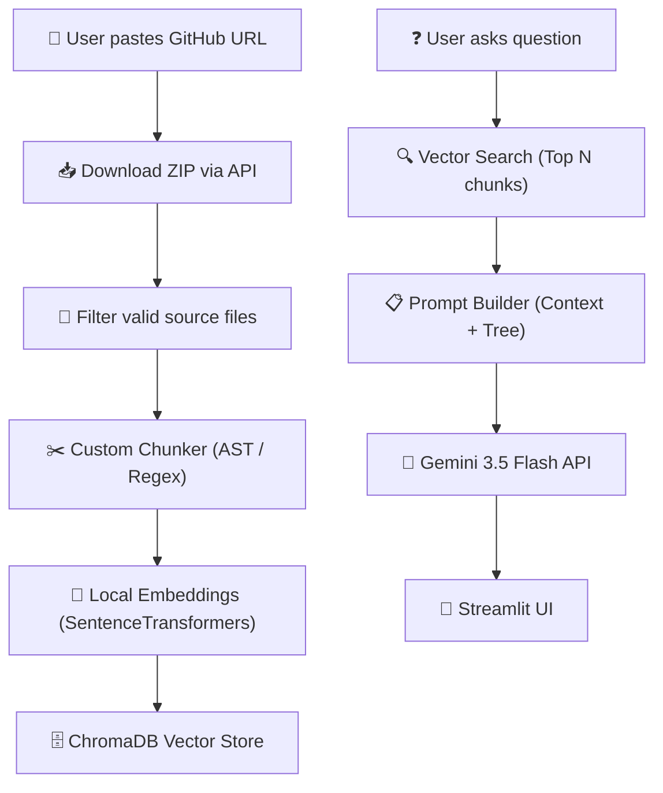

# 🧠 Codebase AI Assistant

An intelligent, RAG-based AI assistant that analyzes entire GitHub repositories and answers complex architectural and code-level questions. Built without heavy frameworks like LangChain to maintain full control over the chunking and embedding pipeline.

## ✨ Features

- **Custom AST Code Chunker**: Uses Python's native `ast` module to intelligently split Python code at exact function and class boundaries, accurately handling decorators, docstrings, and async definitions. Falls back to Regex for JS/Java/C++.
- **Zero-Cost Local Embeddings**: Uses `sentence-transformers` (`all-MiniLM-L6-v2`) to generate vector embeddings entirely locally on your CPU.
- **Fast Semantic Search**: Stores and retrieves code chunks using **ChromaDB**.
- **No Local Git Required**: Directly fetches repositories as ZIP archives via the GitHub API, making it extremely fast and platform-independent.
- **Generative AI Responses**: Uses the modern `google-genai` SDK and `gemini-3.5-flash` to synthesize accurate, codebase-aware answers.
- **Unified Streamlit UI**: A clean, responsive chat interface that displays retrieved code chunks for full transparency.

## 🏗️ Architecture



## 🚀 Getting Started

### Prerequisites
- Python 3.9+
- A free [Google Gemini API Key](https://aistudio.google.com/app/apikey)

### Installation

1. **Clone the repository**
   ```bash
   git clone https://github.com/yourusername/codebase-ai-assistant.git
   cd codebase-ai-assistant
   ```

2. **Install dependencies**
   ```bash
   pip install -r requirements.txt
   ```

3. **Set up Environment Variables**
   Rename `.env.example` to `.env` and add your API key:
   ```env
   GEMINI_API_KEY=your_api_key_here
   ```

### Running the App

Start the Streamlit server:
```bash
streamlit run app.py
```
Then, open your browser, paste a GitHub URL in the sidebar, click **Index Repository**, and start chatting with the code!

## 💡 Why no LangChain?

This project was built from scratch to demonstrate a deep understanding of Retrieval-Augmented Generation (RAG). Instead of relying on black-box LangChain wrappers, the code chunking, vector embedding, and prompt building pipelines were written manually. This ensures that codebase boundaries (like classes and functions) are preserved accurately rather than relying on arbitrary character limits.

## 📝 License
MIT License
