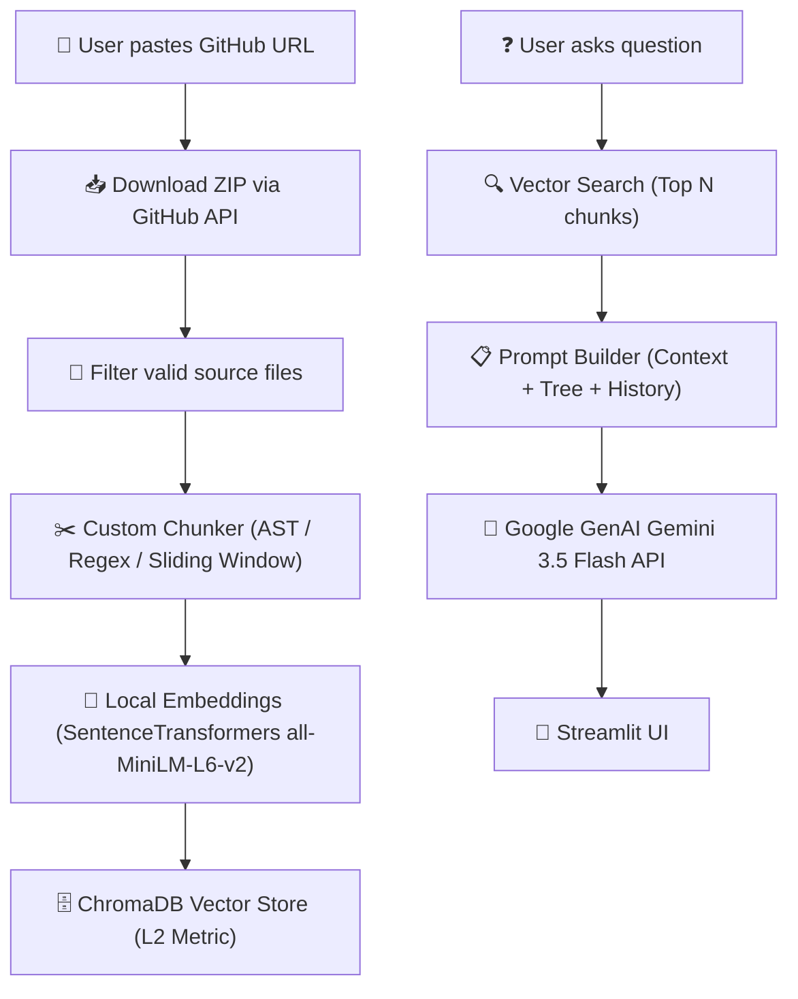

# 🧠 CodeInsight AI Assistant (Codebase AI RAG)

An intelligent, production-grade Retrieval-Augmented Generation (RAG) assistant that indexes GitHub repositories and answers complex architectural and code-level questions. Built without black-box framework abstractions (like LangChain) to maintain complete transparency, instrumentation, and control over chunking, embedding, vector retrieval, and prompt construction.

---

## ✨ Features

- **Custom AST Code Chunker**: Uses Python's native `ast` module to split Python code at exact function and class boundaries, accurately handling decorators, docstrings, and async definitions. Employs regex and sliding-window fallbacks for JavaScript, Java, and C++.
- **Zero-Cost Local Embeddings**: Employs `sentence-transformers` (`all-MiniLM-L6-v2`, 384 dimensions) to generate vector embeddings locally on CPU.
- **Fast Semantic Search**: Stores and retrieves code chunks using **ChromaDB** with isolated per-repository collections.
- **No Local Git Required**: Directly fetches repositories as ZIP archives via the GitHub API, making it fast and platform-independent.
- **Generative AI Responses**: Uses the modern `google-genai` SDK and `gemini-3.5-flash` to synthesize accurate, codebase-aware answers with conversation history support.
- **Unified Streamlit UI**: A clean, responsive chat interface displaying retrieved code chunks and full transparency.
- **Rigorous Evaluation Harness**: Built-in 60-question gold-standard benchmark across Python (`flask`), JavaScript (`express`), and C++ (`fmt`) measuring Hit Rate@K, MRR@K, NDCG@K, Span Recall, and Latency percentiles.

---

## 🏗️ Architecture



---

## 📁 Repository Organization

```text
├── app.py                         # Streamlit UI, chunking/retrieval selectors & session state
├── chunker.py                     # Strategy dispatcher + V0 AST/regex/sliding-window chunker
├── chunker_v1.py                  # Day 3 code-aware, <=256-token hierarchical AST + brace chunker
├── embedder.py                    # ChromaDB client, dense/BM25/hybrid RRF search & cache hydration
├── retrieval/                     # 🔍 Day 4+ modular retrieval package
│   ├── __init__.py
│   ├── bm25_retriever.py          # Code-aware Okapi BM25, V1 header hygiene & Chroma hydration
│   └── hybrid_retriever.py        # Reciprocal Rank Fusion (RRF k=60) & candidate union logic
├── llm.py                         # Gemini API client, secret sanitization & prompt construction
├── repo_loader.py                 # GitHub repository ZIP downloader & source file extractor
├── telemetry.py                   # Atomic telemetry persistence & latency instrumentation
├── requirements.txt               # Pinned project dependencies
├── .env.example                   # Environment configuration template
│
├── evaluation/                    # 📏 Shared retrieval & latency metrics package
│   ├── __init__.py
│   └── retrieval_metrics.py       # Hit@K, Precision@5, Span Recall, MRR@5, corpus NDCG@5, P50/P95
│
├── reports/                       # 📊 Daily engineering audits, benchmarks & progress reports
│   ├── README.md                  # Index of daily reports and engineering roadmap
│   ├── day1/                      # Day 1: Baseline Architecture & V0 Evaluation
│   │   ├── DAY1_PROJECT_AUDIT.md          # Technical audit of existing architecture & constraints
│   │   ├── DAY1_INSTRUMENTATION_REPORT.md  # Verification of baseline instrumentation & timers
│   │   ├── DAY1_TASK3_REPORT.md            # Benchmark dataset curation (60 questions across 3 repos)
│   │   └── DAY1_FINAL_REPORT.md            # Final V0 baseline benchmark results & failure analysis
│   └── day2/                      # Day 2: Embedding Optimization & Controlled Retrieval Experiment
│       └── DAY2_TASK1_REPORT.md            # Controlled ONNX comparison across E0, E1a, E1b, E2, E3
│   └── day3/                      # Day 3: Code-Aware Chunking Optimization
│       ├── DAY3_CHUNKING_AUDIT.md          # Pre-modification V0 chunker & tokenizer audit
│       └── DAY3_CHUNKING_ANALYSIS.md       # Controlled Day 3 comparison & Day 4 recommendation
│   └── day4/                      # Day 4: Hybrid Retrieval (BM25 + Dense + RRF)
│       └── DAY4_HYBRID_REPORT.md           # Single-pass hybrid benchmark & Day 5 handoff analysis
│
├── experiments/                   # 🔬 Evaluation harness & experimental artifacts
│   ├── run_baseline_evaluation.py # Reproducible V0 offline evaluation runner
│   ├── embedding_experiments/     # Day 2 isolated ONNX embedding comparison harness
│   │   ├── configs/embedding_models.json    # Model registry & preprocessing configs
│   │   ├── run_embedding_comparison.py      # Controlled benchmark & timing-decoupled runner
│   │   └── results/                         # embedding_summary.json, embedding_comparison.json, per_model/
│   ├── chunking_experiments/      # Day 3 controlled chunking comparison harness
│   │   ├── validate_baseline_v0.py          # Pre-modification V0 Day 1 parity validator
│   │   ├── run_chunking_comparison.py       # Controlled 3-strategy benchmark (C0/C1/C2)
│   │   └── results/                         # chunking_summary.json, chunking_comparison.json, per_strategy/
│   ├── day4_hybrid/               # Day 4 isolated hybrid retrieval harness
│   │   ├── run_hybrid_comparison.py         # Single-pass Dense/BM25/RRF benchmark & bootstrap CI
│   │   └── results/                         # hybrid_summary.json, hybrid_comparison.json, per_method/
│   ├── datasets/                  # Ground truth annotations and evaluation questions
│   │   ├── repositories.json      # Pinned repository metadata & commit SHAs
│   │   ├── evaluation_questions.json # 60 evaluation questions (conceptual, identifier, conversational)
│   │   ├── ground_truth.json      # Verified evidence line ranges & justifications
│   │   └── validate_dataset.py    # Automated dataset integrity & alignment validator
│   └── results/                   # Experimental records and baseline metrics
│       ├── baseline_evaluation.json # Detailed per-query retrieval results (60 records)
│       ├── baseline_summary.json    # Aggregated metrics, breakdowns & latency distributions
│       ├── baseline_run.json        # Live application telemetry records
│       ├── synthetic_baseline_run.json # Fixture reference telemetry records
│       └── day2_embedding_analysis.md  # Concise Day 2 embedding comparison analysis
│
└── tests/                         # 🧪 Automated regression & verification test suites
    ├── README.md                  # Test suite overview and execution commands
    ├── test_baseline_instrumentation.py # Smoke tests for chunker, embedder, loader, LLM & telemetry
    ├── test_task4_corrections.py        # NDCG mathematical validity, failure accounting & latency tests
    ├── test_retrieval_metrics.py        # Metric module unit & Day 1 parity tests
    ├── test_embedding_runner.py         # Embedding runner ONNX smoke & failure accounting tests
    ├── test_chunker_v1.py               # Code-aware V1 chunker, tokenizer budget & Chroma tests
    ├── test_chunking_comparison.py      # Day 3 chunking harness & 24-metric validation tests
    └── test_bm25_and_hybrid.py          # Code-aware BM25, RRF fusion & Chroma hydration tests
```

---

## 📊 V0 Baseline Benchmark Results (Day 1)

Evaluated across **54 answerable questions** against pinned repository snapshots (`pallets/flask`, `expressjs/express`, `fmtlib/fmt`):

| Metric | V0 Baseline Score | Percentage | Description |
| :--- | :---: | :---: | :--- |
| **Hit Rate@1** | `0.3148` | 31.5% | First retrieved chunk is relevant |
| **Hit Rate@3** | `0.5741` | 57.4% | At least one relevant chunk in Top-3 |
| **Hit Rate@5** | `0.6667` | 66.7% | At least one relevant chunk in Top-5 |
| **Precision@5** | `0.1815` | — | Average fraction of relevant chunks in Top-5 |
| **MRR@5** | `0.4534` | — | Mean Reciprocal Rank ($1/\text{rank}$) |
| **Span Recall@5** | `0.5556` | 55.6% | Fraction of unique ground-truth spans retrieved |
| **NDCG@5** | `0.3339` | — | Normalized against total relevant chunks in repo (capped at 5) |
| **Answerable Latency (N=54)** | `187.62 ms` | — | Mean: 187.62 ms, Median: 187.20 ms, P95: 212.50 ms |
| **All Queries Latency (N=60)** | `187.80 ms` | — | Mean: 187.80 ms, Median: 187.60 ms, P95: 212.50 ms |

See [reports/day1/DAY1_FINAL_REPORT.md](reports/day1/DAY1_FINAL_REPORT.md) for full breakdowns by repository, query style, and category.

---

## 🚀 Getting Started

### Prerequisites
- Python 3.9+ (Tested on Python 3.14)
- A free [Google Gemini API Key](https://aistudio.google.com/app/apikey)

### Installation

1. **Clone the repository**
   ```bash
   git clone https://github.com/gaurav-raj5123/codeinsight-ai.git
   cd codeinsight-ai
   ```

2. **Install dependencies**
   ```bash
   pip install -r requirements.txt
   ```

3. **Configure Environment Variables**
   Create a `.env` file from `.env.example`:
   ```bash
   cp .env.example .env
   ```
   Add your Gemini API key:
   ```env
   GEMINI_API_KEY=your_gemini_api_key_here
   ```

### Running the Application

Start the Streamlit user interface:
```bash
streamlit run app.py
```
Open your browser at `http://localhost:8501`, paste a GitHub repository URL in the sidebar, click **Index Repository**, and begin querying the codebase!

---

## 🧪 Running Tests & Benchmark Evaluation

```bash
# 1. Run full pytest verification suite (metrics, Day 1/2/3 runners & chunker V1)
python -m pytest tests/ -v

# 2. Run baseline instrumentation smoke tests
python tests/test_baseline_instrumentation.py

# 3. Validate benchmark dataset integrity & pinned commit SHAs
python experiments/datasets/validate_dataset.py

# 4. Execute the Day 2 controlled ONNX embedding comparison benchmark
python experiments/embedding_experiments/run_embedding_comparison.py

# 5. Execute the Day 3 controlled chunking comparison benchmark
python experiments/chunking_experiments/run_chunking_comparison.py

# 6. Execute the Day 4 controlled hybrid retrieval benchmark
python experiments/day4_hybrid/run_hybrid_comparison.py
```

---

## 📝 License
MIT License
