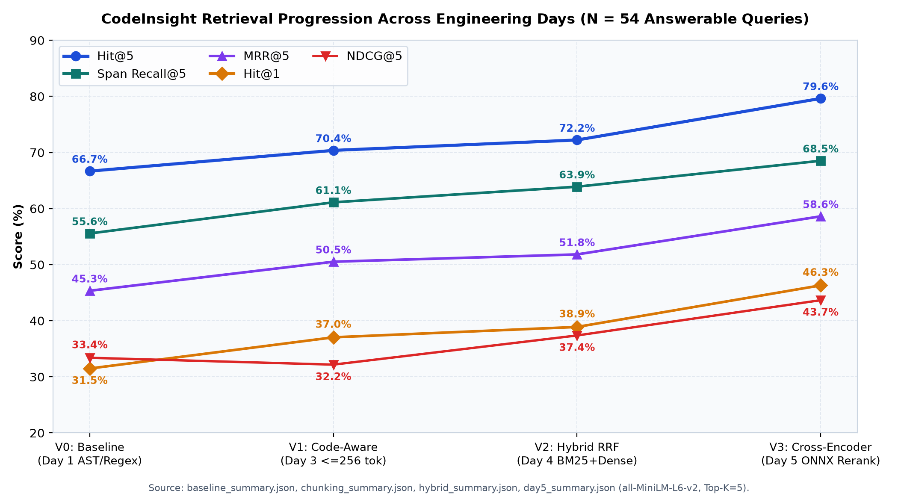
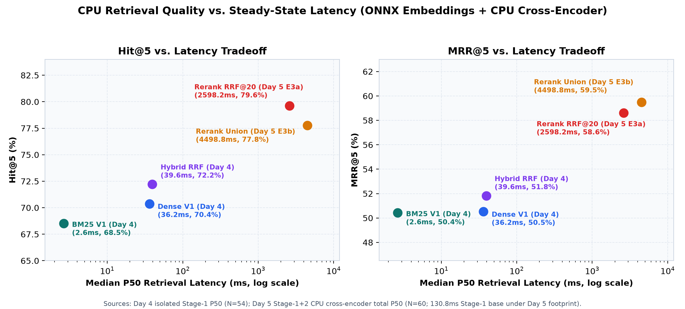
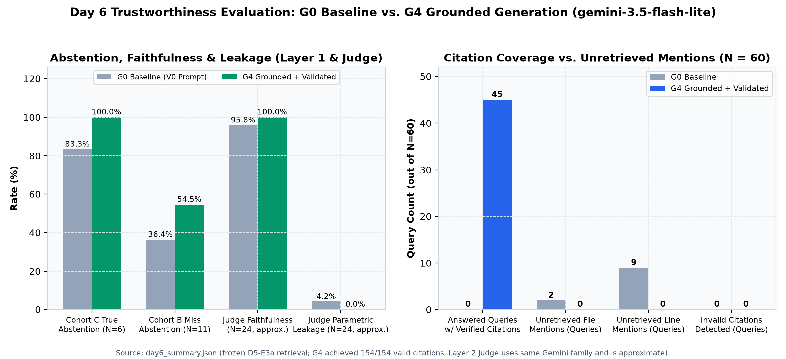

# CodeInsight AI Assistant — 7-Day Controlled RAG Engineering Summary

**Version:** `v1.0.0` (Day 7 Release Freeze)  
**Repository:** [codeinsight-ai](https://github.com/gaurav-raj5123/codeinsight-ai)  
**Target Domain:** Framework-free Codebase Retrieval-Augmented Generation (Python / JavaScript / C++)  
**Execution Stack:** Local ONNX Runtime (`CPUExecutionProvider`, zero PyTorch/`sentence-transformers`) · ChromaDB (Squared $L_2$) · Okapi BM25 + RRF · Google GenAI SDK (`google-genai`) · Streamlit

---

## 1. Executive Summary

Across a disciplined **7-day controlled engineering roadmap**, **CodeInsight AI Assistant** was systematically audited, instrumented, benchmarked, upgraded, and hardened from a fragile naive prototype (`V0`) into a transparent, citation-verified codebase RAG system (`V4`):

- **End-to-End Retrieval Quality (`N = 54` answerable queries across `pallets/flask`, `expressjs/express`, `fmtlib/fmt`):**
  - **Hit@5:** `0.6667` (`36/54`) $\rightarrow$ **`0.7963` (`43/54`)** (**`+0.1296` / `+19.4%` relative**, reaching **`0.9545` / `21/22`** on identifier queries and **`0.9167` / `11/12`** on conversational Turn-2 queries without rewriting)
  - **Hit@1:** `0.3148` $\rightarrow$ **`0.4630`** (`+0.1482` / **`+47.1%` relative**; **`0.4815`** on `Candidate Union`)
  - **MRR@5:** `0.4534` $\rightarrow$ **`0.5861`** (`+0.1327` / **`+29.3%` relative**; **`0.5948`** on `Candidate Union`)
  - **Span Recall@5:** `0.5556` $\rightarrow$ **`0.6852`** (`+0.1296` / **`+23.3%` relative**)
  - **NDCG@5:** `0.3339` $\rightarrow$ **`0.4366`** (`+0.1027` / **`+30.8%` relative**)
  - **Token Truncation:** `624` / `4,272` (`14.61%`) embedding chunks truncated in `V0` $\rightarrow$ **`0` (`0.00%`)** in both Stage-1 embeddings and Stage-2 `512`-token Cross-Encoder pairs.
- **Trustworthy Grounded Generation (`N = 60`, `gemini-3.5-flash-lite` on frozen `D5-E3a` evidence):**
  - **Deterministic Citation Validity (`G4`):** **`1.0000` (`154/154` tokens)** across **`100%` (`45/45`)** of answered queries (`0` invalid citations, `0` unretrieved file mentions vs. `2` in `G0`, `0` unretrieved line mentions vs. `9` in `G0`) at **`0.3278 ms` median offline overhead** and `0` extra LLM calls.
  - **Unanswerable & Retrieval-Miss Calibration:** Cohort C (`N=6`) true abstention improved from **`83.3%` (`5/6`) $\rightarrow$ `100.0%` (`6/6`)**; Cohort B (`N=11` misses) abstention rose **`36.4%` $\rightarrow$ `54.5%`** (with the remaining `5/11` grounded strictly as `"partial"`).
  - **Approximate Blinded LLM Judge (`N = 24` stratified, same Gemini family):** Strict faithfulness **`95.8%` $\rightarrow$ `100.0%` (`24/24`)**, parametric leakage **`4.2%` (`1/24`) $\rightarrow$ `0.0%` (`0/24`)**.

---

## 2. Benchmark Construction & Strict Experimental Controls

To guarantee apples-to-apples attribution across Days 1–6 without metric drift:

1. **Pinned Immutable Snapshots (`253` total source files):**
   - [`pallets/flask`](../experiments/datasets/repositories.json): commit `49943b5a94413a530761350f04e896f76e8d620e` (`83` `.py` files)
   - [`expressjs/express`](../experiments/datasets/repositories.json): commit `43fca52d28a422c8be48fd489cbd4f2d6152bab6` (`142` `.js` files)
   - [`fmtlib/fmt`](../experiments/datasets/repositories.json): commit `3be6709f575a609620f5dd82a9ab2fa91bef6a5e` (`28` `.h`/`.c`/`.py` files)
2. **Gold-Standard Span Dataset (`60` queries, `71` evidence spans):**
   - **54 Answerable** (`18` per repo; `22` `identifier`, `20` `conceptual`, `12` Turn-2 `conversational`; `17` multi-span queries) evaluated purely on raw `"question"` strings (never leaking `expected_standalone_query`) using interval overlap: `(chunk.file_path == span.file_path) and (max(chunk.start_line, span.start_line) <= min(chunk.end_line, span.end_line))`.
   - **6 Unanswerable** (`flask_019/020`, `express_019/020`, `fmt_019/020`) preserved solely for distance/logit calibration and Cohort C abstention evaluation.
3. **Mathematically Sound Shared Metrics ([`evaluation/retrieval_metrics.py`](../evaluation/retrieval_metrics.py)):**
   - Fixed `Precision@5` denominator (`/ 5.0`), deduplicated span recall against unique `71` spans, corpus-wide `IDCG@5` over all relevant chunks in the indexed repository capped at 5 (never `min(len(spans), 5)`), exact `0.0` score attribution on failed queries, and nearest-rank `P95` separation between `N=54` answerable and `N=60` all-query latencies.
4. **Cross-Day Parity Verification:** Day 3 `validate_baseline_v0.py`, Day 4 `D4-E0_dense_v1`, Day 5 `D5-Base_hybrid_rrf`, and Day 6 `freeze_evidence.py` (`300/300` chunks) all verified **exact `0.0` metric delta** against preceding frozen baselines before adding new variables.

---

## 3. Master Retrieval Progression (`V0` $\rightarrow$ `V3`, `N = 54`)

| System Version | Day | Key Mechanism | Chunks | Hit@1 | Hit@3 | Hit@5 | Prec@5 | SpanRec@5 | MRR@5 | NDCG@5 | Truncation |
| :--- | :-: | :--- | :---: | :---: | :---: | :---: | :---: | :---: | :---: | :---: | :---: |
| **`V0`: Baseline** | 1 | `existing_chunker_v0` + Dense L2 (`MiniLM-L6-v2`) | `4,272` | `0.3148` | `0.5741` | `0.6667` | `0.1815` | `0.5556` | `0.4534` | `0.3339` | `14.61%` |
| **`V1`: Code-Aware** | 3 | `code_aware_v1` (AST + Brace + `<=256` WordPiece) | `3,721` | `0.3704` | `0.6296` | `0.7037` | `0.2185` | `0.6111` | `0.5052` | `0.3217`\* | **`0.00%`** |
| **`V2`: Hybrid RRF** | 4 | Dense@20 + Code-Aware BM25@20 + RRF (`k=60`) | `3,721` | `0.3889` | `0.6296` | `0.7222` | `0.2444` | `0.6389` | `0.5182` | `0.3737` | **`0.00%`** |
| **`V3` (`D5-E3a`)** | 5 | `V2` RRF Top-20 $\rightarrow$ CPU ONNX Cross-Encoder | `3,721` | `0.4630` | **`0.7037`** | **`0.7963`** | **`0.2704`** | **`0.6852`** | `0.5861` | `0.4366` | **`0.00%`** |
| *`D5-E3b` (Alt Pool)* | 5 | *Candidate Union (`<=40`) $\rightarrow$ ONNX Cross-Encoder* | `3,721` | ***`0.4815`*** | `0.7037` | `0.7778` | `0.2667` | `0.6759` | ***`0.5948`*** | ***`0.4391`*** | ***`0.00%`*** |

*\*Note on Day 3 NDCG@5 (`0.3339` $\rightarrow$ `0.3217`): Restoring missing module-level bindings and properly splitting large C++ files created more relevant sub-chunks per ground-truth span in the corpus, enlarging `IDCG@5` denominators even as Top-1/Top-5 retrieval strictly improved (`Hit@1 +5.56%`, `MRR@5 +5.18%`, `SpanRec@5 +5.55%`).*

---

## 4. Day-by-Day Technical Findings & Rejected Alternatives

### Day 1 — Audit, Timing Decoupling & V0 Baseline ([`DAY1_FINAL_REPORT.md`](day1/DAY1_FINAL_REPORT.md))
- Separated `collection.add()` ONNX batch insertion time from file I/O and chunking, fixed Chroma telemetry double-counting, and replaced naive `min(len(spans), 5)` `IDCG` logic with corpus-level interval matching.
- **Finding:** Unanswerable Top-1 squared $L_2$ distances (`[0.8314, 1.2868]`) overlapped heavily with answerable queries (`[0.3949, 1.5378]`), proving distance thresholds alone cannot safely abstain.

### Day 2 — Controlled ONNX Embedding Bake-Off ([`DAY2_TASK1_REPORT.md`](day2/DAY2_TASK1_REPORT.md))
- Evaluated 5 ONNX configurations on identical `4,272` V0 chunks (`all-MiniLM-L6-v2` vs `BAAI/bge-small-en-v1.5` no-prefix/instruct vs `intfloat/e5-small-v2` vs `all-MiniLM-L12-v2`).
- **Key Negative Results:**
  - `all-MiniLM-L12-v2` (`max_seq_length=128`) truncated **`31.98%` (`1,366`)** of chunks, crashing `Hit@5` from `0.6667` to `0.4815` and proving token budget alignment outweighs parameter depth.
  - `E1a`/`E2` spiked peak RSS (`1,852.9 MB` / `1,875.7 MB` vs `625.6 MB` on `MiniLM-L6-v2`) without beating V0 `Hit@5` (`0.6111` / `0.6481` vs `0.6667`).
  - `E1b` (`BGE-small` + instruct prefix) topped `NDCG@5` (`0.3661`) and identifier queries (`Hit@5=0.7727`), but `all-MiniLM-L6-v2` retained top `Hit@5` (`0.6667`) and `MRR@5` (`0.4534`) at `86.20 MB`.

### Day 3 — Code-Aware Chunking (`chunker_v1.py`, [`DAY3_CHUNKING_ANALYSIS.md`](day3/DAY3_CHUNKING_ANALYSIS.md))
- **Root Causes Diagnosed in V0:** Python `ast.walk()` self-duplicated **`436`** nested blocks (`255` excess exact duplicates); **`66/83`** Flask files lost module-level imports/`LocalProxy` bindings; JS regex split on `if`/`for`/`catch` emitting **`473`** 1-line fragments; **`624` (`14.61%`)** chunks exceeded 256 tokens (leaving **`57.75%` / `41/71`** GT spans with zero untruncated overlapping chunks).
- **V1 Solution:** Hierarchical top-level Python `ast` + stateful JS/C++ brace/comment/preprocessor scanner + binary-search WordPiece token budgeter (`max_tokens=256`) using the exact runtime ONNX tokenizer, attaching compact headers (`File`, `Language`, `Type`, `Class`/`Symbol`, `Part i/N`, continuation signature).
- **Outcome:** `-12.9%` fewer vectors (`4,272 -> 3,721`), `-24.5%` faster end-to-end indexing (`351.49s -> 265.37s`), **`100%` non-empty line coverage**, **`0.00%` truncation** (`71/71` GT spans completely intact under 256 tokens), and `+5.56%` `Hit@1` / `+5.18%` `MRR@5` (`0.5052`). Also crushed the `fixed_window_v0` control (`Hit@5=0.6481`, `89.24%` truncated).

### Day 4 — Hybrid Retrieval & Candidate Ceiling Discovery ([`DAY4_HYBRID_REPORT.md`](day4/DAY4_HYBRID_REPORT.md))
- **Engineering Hygiene:** Added `strip_v1_header_labels()` (removing static keys like `File:`/`Class:` while preserving symbol/path values), code-aware compound tokenization (`app.engine`, `fmt::format`, `include/fmt/os.h`, camelCase/`snake_case`, 1–2 char symbols), strict `overlap_count >= 1` filtering (preventing zero-overlap noise padding), ChromaDB-hydrated BM25 caching (`st.cache_resource`, zero pickles), and `RRF k=60`.
- **Outcome:** `D4-E2` topped both Dense and BM25 across all 7 metrics (`Hit@5=0.7222`, `NDCG@5=0.3737`, `+3.48 ms` isolated P50 overhead over Dense: `36.08 ms -> 39.56 ms`).
- **Pivot Discovery:** `Dense@20` (`0.8889`) $\cup$ `BM25@20` (`0.8704`) reached **`0.9630` Hit Rate (`52/54`)** and **`0.9074` Span Recall** — **`13` of `15` Top-5 misses were already inside the Stage-1 candidate pool** (`12` inside `RRF@20`). Ranking, not candidate generation, was the Stage-1 bottleneck.

### Day 5 — CPU ONNX Cross-Encoder & Honest Rewriting Ablation ([`DAY5_RERANK_REWRITE_REPORT.md`](day5/DAY5_RERANK_REWRITE_REPORT.md))
- **ONNX Cross-Encoder:** Deployed `cross-encoder/ms-marco-MiniLM-L-6-v2` (rev `233902d25c44`, `86.80 MB`, `max_length=512`) strictly with `onnxruntime` + `tokenizers` (`CPUExecutionProvider`) using verified `[0]/[1]` `token_type_ids` and `only_second` candidate-first truncation with oversized-query protection. **`0 / 1,200` (`D5-E3a`) and `0 / 2,026` (`D5-E3b`) pairs truncated.**
- **Result:** `D5-E3a` (`RRF Top-20` $\rightarrow$ Rerank) lifted `Hit@5` by `+7.41%` to **`0.7963` (`43/54`)** and `MRR@5` to **`0.5861`** at `2,598.23 ms` total CPU P50 (`2,456.04 ms` rerank). `D5-E3b` (`Union <= 40`) traded `1.73x` higher CPU latency (`4,498.75 ms` P50) for `+0.0185` `Hit@1` (`0.4815`) and `+0.0087` `MRR@5` (`0.5948`) while dipping `-0.0185` on `Hit@5` (`0.7778`). **`D5-E3a` was selected as default `hybrid_rerank`.**
- **Rejected Default — Conversational Query Rewriting (`D5-Q1`):** Although rewriting fixed `flask_002` (`null -> #1`) and improved `express_010` (`#3 -> #1`), `D5-E3a` alone already solved **`11/12` (`0.9167`)** Turn-2 queries without an LLM call. Live Gemini `Q1` triggered `4/12` API stalls (`503`/timeouts up to `32.7s`, safely falling back) and over-specified 3 passing queries (`flask_009`, `flask_014`, `fmt_014`), dropping Turn-2 `Hit@5` from `0.9167` to **`0.7500`**. Hence rewriting ships **opt-in (`default = False`)**.
- **Calibration Finding:** Cross-encoder raw logits overlapped (`Answerable`: `[-10.05, +7.70]` vs `Unanswerable`: `[-9.87, +2.46]`, including `fmt_020` at logit `+2.46` / `sigmoid=0.9212`), confirming `sigmoid(logit)` cannot serve as an abstention gate.

### Day 6 — Grounded Generation & Offline Citation Validation ([`DAY6_GROUNDED_GENERATION_REPORT.md`](day6/DAY6_GROUNDED_GENERATION_REPORT.md))
- **Gaps Closed (`generation/`):** `llm.build_prompt()` previously urged using the unverified ASCII `directory_tree`, injected raw `Assistant:` history without trust markers, duplicated V1 headers, and lacked timeouts/retries.
- **Controlled Study (`G0`–`G4`, `204/204` live `gemini-3.5-flash-lite` calls):**
  - Eliminated unretrieved file mentions (`2 -> 0`) and unretrieved line mentions (`9 -> 0`, catching `G0`'s fabricated `lib/utils.js:51-60` citation in `express_015`).
  - Achieved **`100.0%` (`154/154`)** token-level citation validity across **`100.0%` (`45/45`)** of answered queries in `0.3278 ms` median offline post-processing.
  - Raised Cohort C (`N=6`) true abstention from **`83.3% -> 100.0%`** and Cohort B (`N=11`) abstention from **`36.4% -> 54.5%`**, with Blinded Judge (`N=24` approx.) reaching **`100.0%` strict faithfulness** (`24/24`) and **`0.0%` parametric leakage** (`0/24`).
  - Lowered `P95` generation latency vs. `G0` (`2.1810s` vs. `2.8393s`; `P50 = 1.8369s`).
- **Quota & Model Finding:** Initial testing on `gemini-3.5-flash` hit a hard `20 RPD` Free Tier limit after `18` completed `G0` calls (`47` total attempts) and exhibited `504` timeouts when thinking wasn't suppressed; `*-lite` achieved `204/204` zero-failure completion (`ThinkingConfig` cleanly omitted on `*-lite`).

### Day 7 — Release Hardening, Visualization & End-to-End Verification
- **Bug Fix (`generation/citations.py`):** Replaced the two-pass citation regex with a single-pass matcher + `_replace_bracket_group` guard so consecutive/comma/single invalid IDs (`[EVIDENCE_99]`, bare `EVIDENCE_88`) render cleanly once as `[UNVERIFIED_CITATION: ...]` instead of nested double-wrapping.
- **UI & Cache Polish (`app.py`, `embedder.py`):** Added bounded LRU (`max_entries=16`) to BM25 Chroma hydration cache, removed duplicate doc comments, added sidebar selector for `Grounded Generation Model` (`gemini-3.5-flash-lite` default / `gemini-3.5-flash` optional), stripped redundant V1 headers in UI source inspection cleanly, and aligned historical replay telemetry cards with live turns.
- **Reproducible Portfolio Suite (`experiments/generate_final_charts.py`, `tests/test_day7_release.py`):** Automated chart generation strictly from JSON artifacts, added `streamlit.testing.v1.AppTest` headless UI smoke verification, cleaned `requirements.txt` (ONNX-only), and verified clean secret/anchor hygiene.

---

## 5. Production Defaults vs. Preserved Configurability

| Component | Default Selection (`v1.0.0`) | User/Developer Options Retained |
| :--- | :--- | :--- |
| **Chunking** | `code_aware_v1` (AST + brace + `<=256` WordPiece) | `existing_chunker_v0`, `fixed_window_v0` |
| **Embeddings** | ONNX `all-MiniLM-L6-v2` (384d, $L_2$) | Day 2 ONNX harness models (`BGE-small`, `E5-small`, `MiniLM-L12`) |
| **Retrieval Stage 1 & 2** | `hybrid_rerank` (`RRF Top-20` $\rightarrow$ CPU ONNX Cross-Encoder) | `hybrid_rrf`, `dense_only`, `bm25_only`, `candidate_union` pool |
| **Query Rewriting** | Opt-in **`False`** (grounded by `0.9167` native Turn-2 `Hit@5`) | Toggleable `"Enable Conversational Query Rewriting (Experimental)"` |
| **Generation Mode** | **`G3 + G4` Grounded (`True`)**, model **`gemini-3.5-flash-lite`** | Optional **`gemini-3.5-flash`** or legacy V0 (`llm.py`) toggle |

---

## 6. Known Limitations & Honest Engineering Boundaries

1. **Benchmark Sample Size (`N = 60`):** `54` answerable and `6` unanswerable queries across `3` OSS repositories do not claim statistical universality across all codebases or proprietary monorepos.
2. **CPU Reranking Latency (`~2.6s` P50):** Scoring 20 cross-encoder pairs on CPU adds `~2.46s` (`D5-E3a`) vs. `~40 ms` isolated Stage-1 Hybrid RRF (`D4-E2`), representing an explicit accuracy-vs-latency knob (`Hit@5 0.7963` vs. `0.7222`).
3. **Top-5 Miss Floor (`20.4%` / `11/54`):** While Stage-1 Union covers `96.3%` (`52/54`) of answerable queries, `11/54` still miss final Top-5 (`D5-E3a`). When core code is absent from Top-5 (`Cohort B`), grounded generation deliberately abstains or stays `"partial"` rather than hallucinating memorized priors.
4. **Same-Family LLM Judge & Semantic Verification Boundary:** Blinded Layer 2 (`N=24`) uses `gemini-3.5-flash-lite` (same family as generator) and is strictly **approximate**. Deterministic `G4` checks (`100%` valid) prove cited spans exist in Top-5, not semantic entailment — though manual Layer 3 audits (`10/10`) confirmed alignment.
5. **Strict Conservative Over-Abstention (`3/43` Cohort A):** On multi-span queries missing a secondary span (`flask_006`, `express_009`, `express_015`), `G3` occasionally set `abstained=True` despite summarizing useful facts from the retrieved span.
6. **Non-Overwriting Free Tier Constraints:** Google Free Tier caps `gemini-3.5-flash` at `20 RPD`; `gemini-3.5-flash-lite` completed `204/204` evaluation calls cleanly and is therefore the recommended out-of-the-box UI default.

---

## 7. Next Engineering Directions Beyond V4

- **Quantized `INT8` / Batched ONNX Cross-Encoder + Adaptive Top-K:** Cut Stage-2 CPU latency from `~2.5s` toward sub-second via dynamic INT8 ONNX quantization and selective rerank depth (`Top-12`/`Top-15` after RRF).
- **Partial-Span Calibration Tuning:** Refine `G3` system examples distinguishing `"partial"` (`abstained=False` when 1+ ground-truth spans answer part of the question) from `"insufficient"` (`abstained=True`).
- **Call-Graph / AST-Import Graph Expansion (`Multi-Hop`):** Retrieve directly imported symbols (1-hop BFS over parsed imports) to close the remaining cross-file `Cohort B` misses (`express_011`, `flask_002`).
- **Repo-Scale Evaluation & Cross-Family Judging:** Expand benchmark beyond 3 repos / 60 queries and run Layer 2 judging with a non-Gemini judge model.
