# DAY 1 — TECHNICAL AUDIT & BASELINE ARCHITECTURE
**Project:** Codebase AI Assistant (RAG)  
**Audit Date:** November 2026  
**Status:** Technical Audit Completed — Baseline Instrumentation Pending.  
**Target File:** `DAY1_PROJECT_AUDIT.md`  

---

## Executive Summary

The **Codebase AI Assistant** is a functional Retrieval-Augmented Generation (RAG) system built with pure Python and Streamlit, intentionally eschewing orchestrator frameworks (such as LangChain or LlamaIndex) in favor of explicit modular stages. The application clones public GitHub repositories, extracts supported source files, splits them into semantic chunks, generates vector embeddings, stores them in ChromaDB, and performs top-$K$ similarity retrieval to augment queries answered by Google's Gemini API (`gemini-3.5-flash`).

### Primary Audit Highlights & Discrepancies
1. **Embedding Implementation Discrepancy:** The project documentation (`README.md`) states that embeddings are generated using `sentence-transformers` (`all-MiniLM-L6-v2`). However, inspection of `requirements.txt`, `git diff`, and `embedder.py` demonstrates that the code was refactored to use ChromaDB's built-in `embedding_functions.DefaultEmbeddingFunction()`, running `all-MiniLM-L6-v2` locally via `onnxruntime` (384 dimensions) to eliminate PyTorch dependencies on Windows.
2. **Retrieval Metric Default (Experimental Question):** ChromaDB is instantiated via `PersistentClient` without custom HNSW index configuration in `get_or_create_collection`. Consequently, ChromaDB operates under its default distance metric: **squared $L_2$ Euclidean distance** (`l2`), rather than cosine distance (`cosine`). Note that the comparative behavior of $L_2$ versus cosine is treated strictly as an experimental question for evaluation, not an established defect; the existing distance metric will remain unchanged during baseline instrumentation.
3. **AST Duplication Hazard:** The Python AST chunker (`ast.walk`) parses functions, async functions, and classes indiscriminately. Because `ast.walk` traverses all descendant nodes, methods inside a class are emitted as standalone `FunctionDef` chunks *and* simultaneously embedded within the parent `ClassDef` chunk, creating significant duplication and context starvation.
4. **Conversational Query Disconnect:** While the generation layer (`llm.py`) receives the last 10 messages of conversation history, the retrieval layer (`embedder.py`) queries ChromaDB using *only* the raw current query string. Follow-up queries containing pronouns or implicit references ("How does it work?", "Where is that called?") suffer from uncontextualized vector retrieval.
5. **Discarded Diagnostic Data:** ChromaDB's `collection.query()` returns `ids` and `distances` along with `documents` and `metadatas`. Currently, `embedder.search_similar()` discards `ids` and `distances`, hindering retrieval evaluation and baseline measurement.

---

## A. Existing Architecture & End-to-End Data Flow

The application executes a linear two-phase lifecycle: **Phase 1: Ingestion & Indexing** and **Phase 2: Retrieval & Generation**.

```mermaid
flowchart TD
    subgraph Phase 1: Ingestion & Indexing
        A["GitHub URL (Input)"] --> B["repo_loader.clone_repo()"]
        B -->|"Extracts ZIP to temp_dir"| C["repo_loader.get_source_files()"]
        B -->|"Walks directory tree"| D["repo_loader.generate_directory_tree()"]
        C -->|"List[Dict]: path, content, ext"| E["chunker.chunk_code()"]
        E -->|"List[Dict]: content, metadata"| F["embedder.index_chunks()"]
        F -->|"ONNX all-MiniLM-L6-v2 (384-d)"| G[("ChromaDB PersistentStore (./chroma_db)")]
        B -.->|"repo_loader.cleanup_repo()"| H[("Disk Temp Cleanup")]
    end

    subgraph Phase 2: Retrieval & Generation
        I["User Question (Input)"] --> J["embedder.search_similar()"]
        G -.->|"Query Top-K (n=5)"| J
        J -->|"Retrieved Chunks [5]"| K["llm.build_prompt()"]
        D -.->|"Directory Tree"| K
        L["st.session_state.messages (Chat History)"] -.->|"Last 10 msgs"| K
        K -->|"Augmented Prompt"| M["llm.ask_gemini()"]
        M -->|"google-genai SDK (gemini-3.5-flash)"| N["AI Answer Synthesis"]
        N --> O["Streamlit Chat UI (app.py)"]
    end
```



### Data Structures & Module Interface Contracts

| Stage | Input Data Structure | Output Data Structure | Key Module / Function |
| :--- | :--- | :--- | :--- |
| **Ingestion** | `github_url: str` | `repo_path: str` (Absolute path to extracted repo root) | `repo_loader.clone_repo` |
| **File Filtering** | `repo_path: str` | `List[Dict[str, str]]`: `[{"file_path", "content", "extension"}]` | `repo_loader.get_source_files` |
| **Tree Generation** | `repo_path: str` | `directory_tree: str` (Formatted text tree) | `repo_loader.generate_directory_tree` |
| **Chunking** | `file_data: Dict[str, str]` | `List[Dict[str, Any]]`: `[{"content": str, "metadata": Dict}]` | `chunker.chunk_code` |
| **Indexing** | `chunks: List[Dict]`, `repo_name: str` | `total_indexed: int` (Persisted in Chroma collection) | `embedder.index_chunks` |
| **Retrieval** | `query: str`, `repo_name: str`, `n_results=5` | `List[Dict]`: `[{"content": str, "metadata": Dict}]` | `embedder.search_similar` |
| **Prompt Assembly** | `question`, `chunks`, `tree`, `chat_history` | `prompt: str` (Single concatenated text prompt) | `llm.build_prompt` |
| **Generation** | `prompt: str` | `response_text: str` | `llm.ask_gemini` |
| **UI State** | `response_text`, `retrieved_chunks` | Updated `st.session_state.messages` list | `app.py` |

---

## B. Existing Implementation Details

### 1. Repository Acquisition (`repo_loader.py: clone_repo`)
- **Extraction Protocol:** Extracts the owner and repository using regex `re.search(r'github\.com/([^/]+)/([^/]+)', github_url)` and strips any `.git` suffix.
- **Download Mechanism:** Directly queries GitHub's REST endpoint: `https://api.github.com/repos/{owner}/{repo}/zipball` using standard library `urllib.request.Request` with `User-Agent: Mozilla/5.0`.
- **Filesystem Workspace:** Creates a unique temporary directory via `tempfile.mkdtemp(prefix="rag_repo_")`, writes the payload to `repo.zip`, and extracts the archive via `zipfile.ZipFile.extractall()`.
- **Folder Resolution:** GitHub zipball packages unpack into an internal directory named `{owner}-{repo}-{commit_hash}`. `clone_repo` inspects `os.listdir(temp_dir)` to return the path of this extracted inner folder.
- **Cleanup Guarantee:** Cleans up temporary artifacts using `shutil.rmtree` with an `onerror` handler to adjust Windows read-only flags (necessary for `.git` or locked file structures).

### 2. Supported File Extensions & Filtering Rules (`repo_loader.py: get_source_files`)
- **Recognized Extensions:** Strictly limits indexing to:
  ```python
  supported_extensions = {".py", ".js", ".java", ".cpp", ".c", ".h", ".ts"}
  ```
- **Blacklisted Directories:** Ignores the following directories during recursive `os.walk` traversal:
  ```python
  ignore_dirs = {".git", "node_modules", "__pycache__", "venv", "env", ".venv", "build", "dist", "target", ".idea", ".vscode"}
  ```
  Pruning is applied in-place to `dirs[:]` to prevent descending into subtrees.
- **Hidden Files & Directories:** Any directory or file starting with a period (`.`) is unconditionally skipped.
- **File Size Ceiling:** Evaluates file size prior to reading:
  ```python
  max_file_size = 100 * 1024  # 100 KB limit per file
  ```
  Files strictly greater than 100 KB are skipped.
- **Encoding & Decoding:** Files are opened with `encoding='utf-8'`. Any file raising `UnicodeDecodeError` is caught and skipped.
- **Path Canonicalization:** Relative paths are computed via `os.path.relpath(file_path, repo_path).replace("\\", "/")` ensuring uniform forward slashes across platforms.

### 3. Repository Structure Generation (`repo_loader.py: generate_directory_tree`)
- Scans the repository using `os.walk`, pruning ignored and hidden directories.
- Strips GitHub's commit hash suffix from the root directory display name:
  ```python
  dir_name = re.sub(r'-[a-f0-9]{7,}$', '', dir_name)
  ```
- Formats a hierarchical visual tree string using indentation, folder emoji (`📂`), and file emoji (`📄`).

### 4. Python AST Chunking (`chunker.py: chunk_python`)
- **Parsing:** Calls Python's built-in `ast.parse(content)`.
- **Target AST Nodes:** Iterates using `ast.walk(tree)` filtering for:
  ```python
  isinstance(node, (ast.FunctionDef, ast.AsyncFunctionDef, ast.ClassDef))
  ```
- **Decorator Handling:** If `node.decorator_list` exists, the start boundary shifts upward to `node.decorator_list[0].lineno`.
- **Boundary Slicing:** Extracts lines from `start_line - 1` to `getattr(node, 'end_lineno', start_line)`.
- **Metadata Assigned:**
  - `file_path`: relative file path string
  - `start_line`: 1-indexed integer
  - `end_line`: 1-indexed integer
  - `chunk_type`: string name of AST node class (`"FunctionDef"`, `"AsyncFunctionDef"`, `"ClassDef"`)
- **Syntax Error Fallback:** If `ast.parse` throws `SyntaxError`, it catches the exception and falls back to `chunk_by_regex(content, file_path, [r'^class \w+', r'^def \w+', r'^\s+def \w+'])`.

### 5. Java, JavaScript / TypeScript, and C / C++ Regex Chunking (`chunker.py`)
Languages other than Python do not use AST parsing; they rely on single-pass regular expression boundary scanning via `chunk_by_regex`:
- **JavaScript / TypeScript (`.js`, `.ts`):**
  - `r'^function \w+'`
  - `r'^(?:export )?(?:const|let|var) \w+ = .*(=>|function)'`
  - `r'^(?:export )?class \w+'`
  - `r'^\s+\w+\s*\(.*\)\s*\{'`
- **Java (`.java`):**
  - `r'^\s*(?:public|private|protected|static|final)\s+[\w<>, ]+\s+\w+\s*\(.*\)\s*(?:throws\s+[\w, ]+)?\s*\{'`
  - `r'^\s*(?:public|private|protected|static|final|abstract)\s+class \w+'`
- **C / C++ (`.cpp`, `.c`, `.h`):**
  - `r'^\w+.*\w+\s*\(.*\)\s*\{'`
  - `r'^class \w+'`
  - `r'^struct \w+'`
- **Mechanics:** Scans line-by-line. When a line matches any of the combined regex patterns and the current accumulator has lines, it emits the accumulated lines as a chunk with `chunk_type = 'regex_split'`. The matched line begins the next chunk.

### 6. Fallback Chunking Strategy & Size Enforcement (`chunker.py`)
- **Sliding Window Fallback (`chunk_by_sliding_window`):**
  - Applied if language-specific chunkers return an empty list (e.g. scripts with no classes/functions, unsupported extensions, or failed regex matching).
  - Window configuration: `window_size = 50` lines, `overlap = 10` lines.
  - Step progression: advances by `window_size - overlap` (40 lines per iteration).
  - If total file lines $\le 50$, emits one chunk representing the entire file.
  - Metadata: `chunk_type = 'sliding_window'`.
- **Secondary Split Enforcement:**
  - In `chunk_code()`, after any chunker returns, every chunk is checked for line count:
    ```python
    if len(chunk['content'].split('\n')) > 100:
    ```
  - Chunks exceeding 100 lines are partitioned into sub-chunks using `chunk_by_sliding_window(window_size=50, overlap=10)`.
  - Sub-chunk metadata is patched:
    - `chunk_type`: `f"{original_chunk_type}_split"`
    - `start_line`: `parent_start_line + sub_start_line - 1`
    - `end_line`: `parent_start_line + sub_end_line - 1`

### 7. Embedding Model & Vector Dimensions (`embedder.py`)
- **Actual Model Used:** `chromadb.utils.embedding_functions.DefaultEmbeddingFunction()`.
- **Underlying Engine:** ChromaDB's ONNX runtime execution of `sentence-transformers/all-MiniLM-L6-v2`.
- **Vector Dimension:** **384** float32 values per embedding vector.
- **Execution Target:** Local CPU execution via `onnxruntime`.

### 8. ChromaDB Vector Store Configuration (`embedder.py`)
- **Client Mode:** `chromadb.PersistentClient(path="./chroma_db")` (persists on local disk).
- **Collection Naming:** Derived from repository name, sanitized to alphanumeric, underscores, and hyphens, constrained to $[3, 63]$ characters:
  ```python
  safe_repo_name = "".join(c if c.isalnum() or c in ('_', '-') else "_" for c in repo_name)[:63].ljust(3, '_')
  ```
- **Collection Lifecycle:** During indexing, if a collection exists with the same name, it is deleted (`client.delete_collection(name=safe_repo_name)`) and recreated via `client.get_or_create_collection(name=safe_repo_name, embedding_function=embedding_fn)`.
- **HNSW Distance Space:** No `metadata={"hnsw:space": ...}` is supplied; ChromaDB defaults to **squared $L_2$ distance** (`"l2"`).
- **Batching:** Insertion is executed in sequential batches of 100 items (`batch_size = 100`).
- **Chunk ID Generation:** Generated sequentially as `f"chunk_{total_indexed + j}"`.

### 9. Top-$K$ Retrieval Mechanics (`embedder.py: search_similar`)
- **Retrieval Call:** Executes `collection.query(query_texts=[query], n_results=n_results)`.
- **Default Depth:** Hardcoded default `n_results = 5`.
- **Data Extracted:** Only extracts `results['documents'][0]` and `results['metadatas'][0]`.
- **Data Dropped:** Discards `results['ids'][0]` and `results['distances'][0]`.

### 10. Chunk Metadata Schema

| Field Name | Type | Emitted By | Description / Example |
| :--- | :--- | :--- | :--- |
| `file_path` | `str` | All chunkers | Relative path to repository root (e.g. `src/utils/parser.py`) |
| `start_line` | `int` | All chunkers | 1-indexed starting line number of chunk in source file |
| `end_line` | `int` | All chunkers | 1-indexed ending line number of chunk in source file |
| `chunk_type` | `str` | Specific chunkers | Type descriptor: `FunctionDef`, `AsyncFunctionDef`, `ClassDef`, `regex_split`, `sliding_window`, or `*_split` |

*Omissions from current metadata:* No commit SHA, repository URL, file extension, programming language tag, symbol/function name, or parent class name.

### 11. Context Augmentation & Prompt Engineering (`llm.py: build_prompt`)
Gemini receives a single structured string prompt formatted as:
```text
You are an expert code analyst. Answer questions about a codebase based ONLY on the provided code context. Be specific — reference file names and line numbers.

CONVERSATION HISTORY (for follow-up context):
User: <msg>
Assistant: <msg>
(End of conversation history)

REPOSITORY STRUCTURE:
<plain text directory tree>

RELEVANT CODE (retrieved from vector search):
---
📄 File: <file_path> | Lines <start_line>-<end_line>
<code_content>
---
...

QUESTION: <user_question>

Rules:
- Reference specific files and line numbers
- If the context doesn't contain enough info, say so
- Use markdown code blocks for code examples
- For architecture questions, use the repository structure above
- If the user's question refers to a previous answer, use the conversation history above for context
```

### 12. Generation & Model Invocation (`llm.py: ask_gemini`)
- **SDK & Client:** Uses official `google-genai` SDK (`from google import genai`).
- **Model Name:** Hardcoded `gemini-3.5-flash`.
- **Call Structure:**
  ```python
  client = genai.Client(api_key=api_key)
  response = client.models.generate_content(
      model="gemini-3.5-flash",
      contents=prompt,
  )
  ```
- **Configuration:** No generation parameters (`temperature`, `top_p`, `max_output_tokens`, or `safety_settings`) are explicitly configured; defaults are used.
- **Streaming:** Responses are received in a single synchronous call (no streaming).

### 13. Conversation History Handling (`app.py` & `llm.py`)
- Stored in Streamlit's `st.session_state.messages` as a list of dictionaries: `[{"role": str, "content": str, "chunks": List}]`.
- Passed to `llm.build_prompt(..., chat_history=st.session_state.messages)`.
- Truncated in `llm.py` via `recent_history = chat_history[-10:]` (retaining at most 5 Q&A interaction pairs).
- Formatted as raw text lines inside the prompt body rather than native multi-turn SDK messages.
- **Critical Gap:** History is completely absent from the retrieval stage; vector search receives only the un-contextualized latest query.

---

## C. Comprehensive Analysis of Existing Limitations

### 1. Retrieval Quality Limitations
- **Squared $L_2$ Distance Metric (Experimental Evaluation Question):** ChromaDB defaults to squared Euclidean distance (`"l2"`). While cosine distance (`"cosine"`) is common in semantic retrieval across text embeddings of varying length, the comparative effectiveness of $L_2$ vs. cosine is treated strictly as an empirical research question for subsequent evaluation, not an established defect. The existing $L_2$ metric will be preserved as the baseline reference and will not be altered during baseline instrumentation.
- **Dense-Only Semantic Search:** Pure vector similarity frequently fails when developers search for exact tokens, such as variable names (`AUTH_TOKEN_HEADER`), specific function names (`handle_webhook_event`), route paths (`/api/v1/checkout`), or error codes (`ERR_CONNECTION_REFUSED`). Without a complementary lexical search mechanism (e.g. BM25), semantic vectors fail to surface exact symbol hits.
- **Fixed Top-$K$ ($K=5$):** Regardless of question scope—whether asking about a single utility function or a broad architectural question spanning dozens of files—retrieval is locked at $K=5$, with no score thresholding to discard irrelevant chunks.
- **Conversational Query Disconnect:** Asking follow-ups such as *"How does it handle token refresh?"* sends that exact sentence to vector search without the antecedent context established in earlier turns.
- **Domain Mismatch of Embedding Model:** `all-MiniLM-L6-v2` was trained on natural language sentence pairs (SNLI, MultiNLI), not source code syntax, AST structures, or programming tokens.

### 2. Chunk Duplication & Overlapping Inefficiencies
- **AST Inner Function & Class Duplication:** `ast.walk` recursively visits all nested nodes. A class with 5 methods produces 6 chunks: 1 enclosing `ClassDef` chunk and 5 individual `FunctionDef` chunks. This duplicates the method bodies in the index and frequently leads to the top-$K$ results being dominated by both the method chunk and its parent class chunk.
- **Top-Level Code Omission:** In Python files, module-level variables, constants, type aliases, top-level execution statements, and `import` headers are completely omitted by the AST chunker because they are not wrapped in a `FunctionDef` or `ClassDef`.
- **Arbitrary Line-Based Splitting:** The fallback and split mechanisms cut code strictly by line count (50 lines, 10 overlap) without checking block or statement integrity, frequently splitting expressions, statements, or parameter lists in half.

### 3. Metadata Consistency & Completeness
- **Minimal Metadata Schema:** Only `file_path`, `start_line`, `end_line`, and `chunk_type` are stored.
- **Lost Identifiers:** Function names (`node.name`), class names, signatures, and docstrings are parsed during AST chunking but never written to metadata.
- **Approximated Sub-Chunk Line Numbers:** Line calculations on split chunks (`sc['metadata']['start_line'] = chunk['metadata'].get('start_line', 1) + sc['metadata']['start_line'] - 1`) are mathematical approximations that drift when decorators or leading whitespace are present.
- **Lack of Repository Provenance:** Chunks have no stored association with the repository URL, commit hash, branch name, or timestamp.

### 4. Cross-File Understanding & Structural Isolation
- **Isolated File Processing:** Each file is chunked in total isolation. No dependency graph, call graph, or module hierarchy is constructed.
- **Import Statements Dropped:** The AST chunker does not capture `ast.Import` or `ast.ImportFrom` nodes. Consequently, cross-file imports are omitted from the retrieved chunks.
- **Unstructured Directory Tree:** The visual ASCII directory tree injected into Gemini's prompt provides high-level structure but contains no machine-readable semantic linkage to the retrieved code chunks.

### 5. Retrieval Reproducibility & Determinism
- **Non-Deterministic Chunk ID Generation:** Chunk IDs (`chunk_0`, `chunk_1`, ...) depend strictly on iteration order. Because `repo_loader.get_source_files` traverses directories using `os.walk` without sorting files, chunk IDs vary across operating systems and filesystems for the identical repository.
- **Non-Deterministic AST Node Order:** `ast.walk` does not guarantee sequential line-order traversal.
- **Ephemeral Index Rebuilding:** Re-indexing a repository wipes the collection (`delete_collection`), generating fresh random HNSW graphs and discarding previous indexing states.

### 6. Evaluation, Logging & Observability Gaps
- **Zero Latency Tracking:** Neither indexing duration, embedding time, retrieval latency, nor Gemini generation latency is recorded or logged.
- **Discarded Similarity Metrics:** Retrieval distances computed by ChromaDB are dropped in `embedder.py` and never exposed to the application or evaluation layers.
- **No Evaluation Infrastructure:** There is no mechanism to compute retrieval recall, precision@K, Mean Reciprocal Rank (MRR), or answer faithfulness.

### 7. Indexing Efficiency & Scalability
- **Strict 100 KB File Threshold:** Files exceeding 100 KB are silently dropped. In many repositories, core schema files, generated client code, or consolidated utilities exceed 100 KB and are completely missing from the index.
- **Unauthenticated GitHub Rate Limiting:** `clone_repo` accesses the GitHub API anonymously, subject to GitHub's rate limit of 60 requests per hour per IP.
- **Monolithic In-Memory Accumulation:** All chunks for an entire repository are accumulated into a single in-memory Python list before batch insertion into ChromaDB.
- **Absence of Incremental Updates:** Any re-index requires re-downloading the entire zipball, re-chunking all files, and re-computing embeddings for the entire repository.

---

## D. Baseline Instrumentation Requirements

To establish a measurable baseline on Day 1 without altering functional behavior or introducing premature Day 2+ features, minimal telemetry and diagnostic capture points must be integrated while strictly preserving backward compatibility.

### Required Telemetry & Metrics Specification

| Telemetry Metric | Capture Point | Current Status | Minimal Integration Method |
| :--- | :--- | :--- | :--- |
| **Repo Name & Commit SHA** | `repo_loader.clone_repo` / helper | Repo name captured; SHA discarded | Extract SHA from inner directory name (`{owner}-{repo}-{sha}`). Preserve backward compatibility of `clone_repo()`. |
| **Indexed Source Files Count** | `repo_loader.get_source_files` | Tracked in `app.py` | Record `len(files)` in execution payload |
| **Generated Chunks Count** | `chunker.chunk_code` / `embedder.index_chunks` | Returned by `embedder.index_chunks` | Record total chunk count |
| **Indexing Latency Breakdown** | `app.py` | Not measured | Accurately measure 4 stages via `time.perf_counter()`: (1) repo download/extraction, (2) chunking, (3) ChromaDB indexing (combined embedding generation + vector insertion), and (4) total indexing time. `collection.add()` duration is explicitly treated as combined embedding + insertion time, not embedding-only time. |
| **Embedding Model & Dimensions** | `embedder.py` | Hardcoded / implicit | Record model identifier (`DefaultEmbeddingFunction` / `all-MiniLM-L6-v2`) and dimension (`384`) |
| **Retrieval Latency** | `embedder.search_similar` | Not measured | Measure `time.perf_counter()` around `collection.query()` as **total retrieval/query latency** (encompassing both query embedding and HNSW vector search). |
| **Retrieved Chunk IDs** | `embedder.search_similar` | Discarded | Preserve `results['ids'][0]` inside returned chunk dictionaries |
| **Retrieved File Paths** | `embedder.search_similar` | Stored in `metadata['file_path']` | Pass through with retrieved chunks |
| **Retrieved Chunk Content** | `embedder.search_similar` | Stored in `chunk['content']` | Pass through with retrieved chunks |
| **ChromaDB Distances & Metric** | `embedder.search_similar` | Discarded | Preserve `results['distances'][0]` in returned chunk dictionaries; record configured distance metric (`"l2"`). Distance metric is not altered. |
| **Generation Latency** | `llm.ask_gemini` | Not measured | Measure `time.perf_counter()` around `generate_content()` call |

### Proposed Standardized Baseline Telemetry Schema
To capture these values systematically without UI disruption, a lightweight telemetry data structure should be recorded per interaction:

```json
{
  "timestamp": "2026-11-24T16:10:00Z",
  "repository": {
    "name": "example-repo",
    "commit_sha": "7fd1a60",
    "files_indexed": 42,
    "chunks_indexed": 218,
    "indexing_time_seconds": {
      "repo_download_extraction": 1.25,
      "chunking": 0.34,
      "chromadb_indexing_combined": 4.12,
      "total_indexing": 5.71
    }
  },
  "retrieval": {
    "query": "How is authentication handled?",
    "total_retrieval_latency_seconds": 0.048,
    "top_k": 5,
    "distance_metric": "l2",
    "results": [
      {
        "id": "chunk_42",
        "distance": 0.8124,
        "file_path": "auth/token.py",
        "start_line": 15,
        "end_line": 45,
        "chunk_type": "FunctionDef"
      }
    ]
  },
  "generation": {
    "model": "gemini-3.5-flash",
    "latency_seconds": 1.62,
    "prompt_length_chars": 3450,
    "response_length_chars": 820
  }
}
```

---

## E. Minimal Modification Surface for Next Task (Task 2)

The following file-by-file roadmap outlines the exact, non-invasive adjustments planned for Task 2 to enable baseline metrics capture. All changes strictly preserve backward compatibility, avoid breaking existing callers or signatures, and preserve existing Streamlit UI layout and functionality:

1. **`repo_loader.py`**:
   - Preserve default return signature of `clone_repo(github_url: str) -> str` so existing callers are unaffected.
   - Extract the commit SHA from the extracted root folder name (`{owner}-{repo}-{commit_hash}`) and provide access either via an optional flag (`clone_repo(github_url, return_commit_sha=False)`) or a dedicated helper function (e.g. `get_repo_commit_sha(repo_path: str)` / `clone_repo_with_metadata()`).
2. **`embedder.py`**:
   - Maintain the default signature and return format of `search_similar(query: str, repo_name: str, n_results: int = 5) -> list[dict]`.
   - Preserve backward compatibility by adding `'id'` (`results['ids'][0][i]`) and `'distance'` (`results['distances'][0][i]`) directly into each returned chunk dictionary alongside `'content'` and `'metadata'`. Existing callers expecting `chunk['content']` and `chunk['metadata']` continue operating without disruption.
   - Measure total retrieval latency around `collection.query()` (query embedding + vector search) and expose retrieval telemetry via an optional parameter or companion helper.
   - Do not alter the existing ChromaDB distance metric (`"l2"`).
3. **`llm.py`**:
   - Maintain the default signature and return type of `ask_gemini(prompt: str) -> str`.
   - Measure generation latency around `client.models.generate_content()` and provide access to the duration via an optional parameter (`return_latency: bool = False`) or a companion helper function (e.g. `ask_gemini_with_metrics()`).
4. **`app.py`**:
   - Accurately measure and record the four indexing stages:
     1. Repository download/extraction latency
     2. Chunking latency
     3. ChromaDB indexing latency (combined embedding + insertion duration)
     4. Total indexing latency
   - Measure total retrieval latency and generation latency.
   - Preserve existing Streamlit UI layout and user flow without unnecessary redesign, displaying baseline diagnostic metrics cleanly inside a collapsible expander (e.g. `📊 Baseline Diagnostics`).

> **Verification Statement:**  
> In strict compliance with instructions, **no application source code was modified during this audit**. All observations and metrics are verified directly against source code and local runtime execution. Baseline instrumentation will commence only upon explicit authorization of Task 2.
